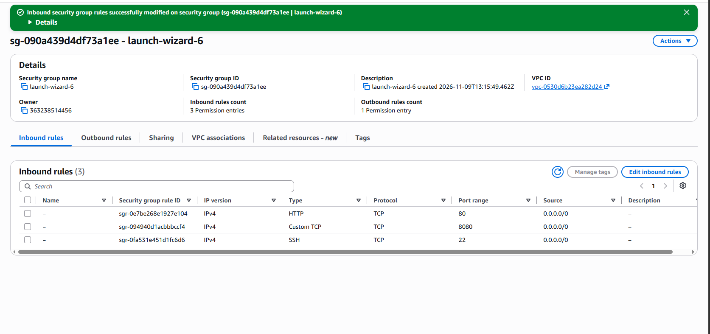
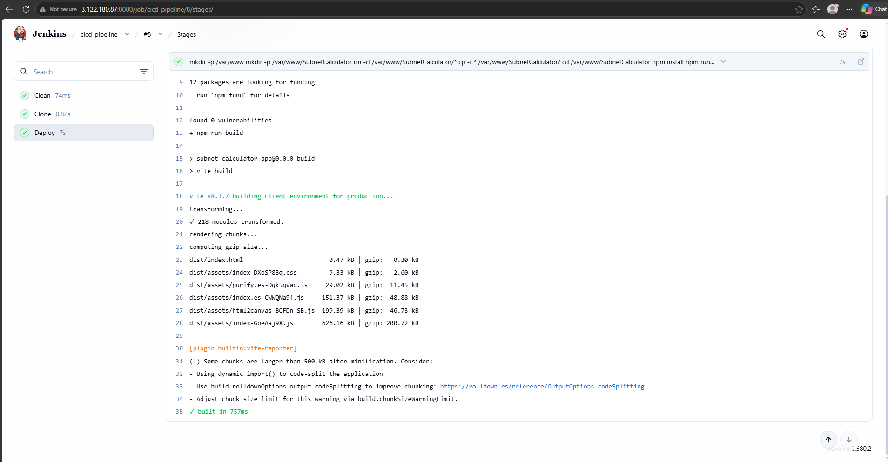
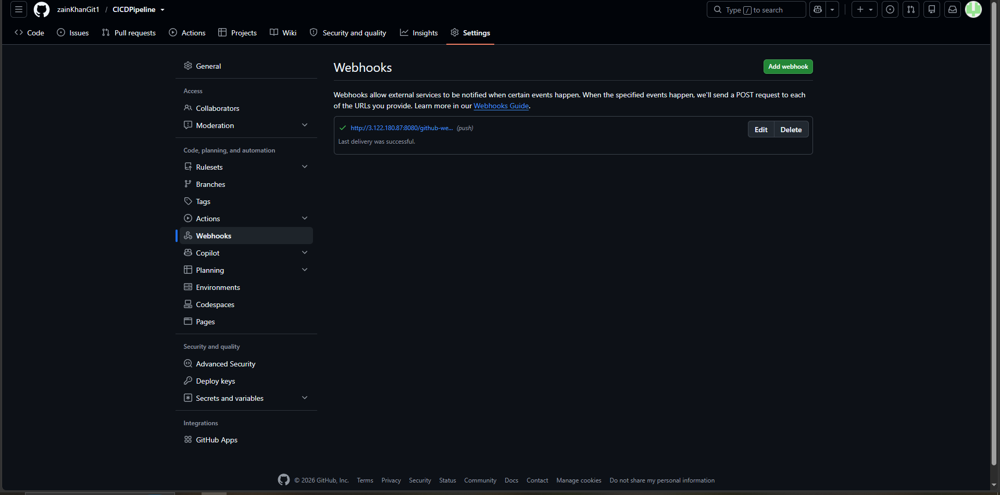
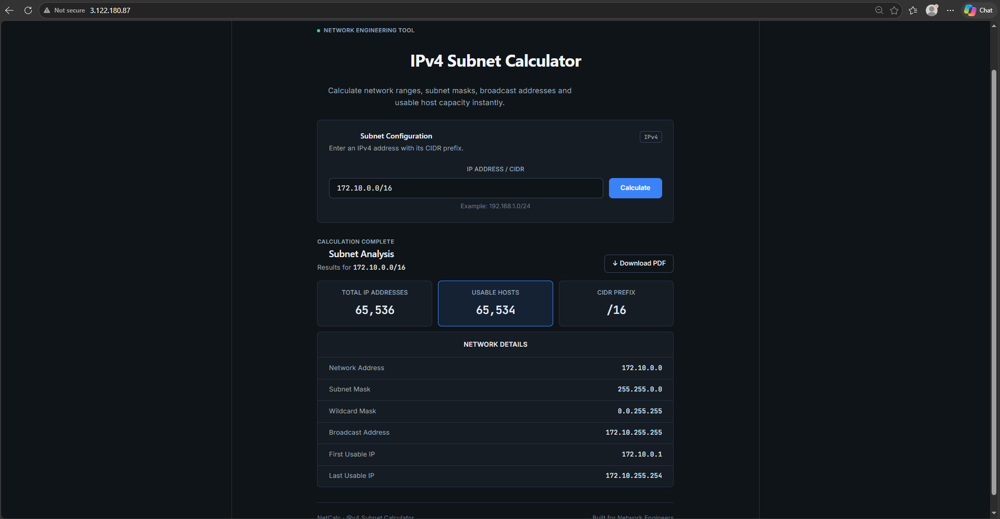
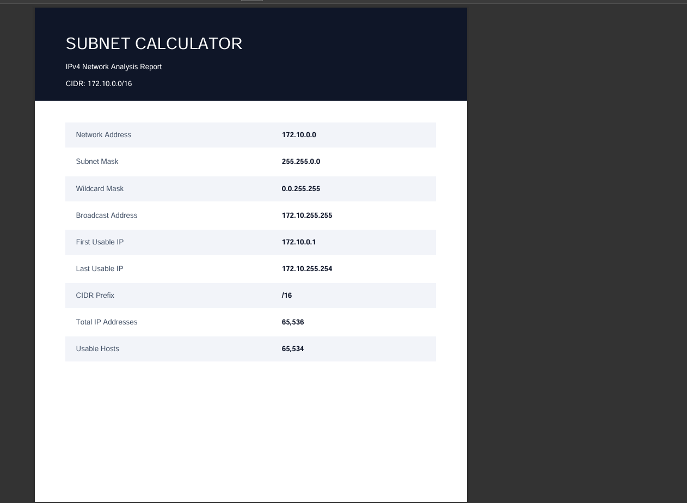

# Jenkins CI/CD Pipeline – Automated Deployment to AWS EC2

## Project Overview

This project demonstrates an automated CI/CD pipeline using Jenkins, GitHub, and AWS EC2.

Whenever new code is pushed to the GitHub repository, a GitHub Webhook automatically triggers the Jenkins pipeline. Jenkins then at first cleans workdir, clones the latest source code from the repository and deploys the application to an AWS EC2 instance.

Jenkins itself is also hosted on an AWS EC2 instance .

## Architecture & Workflow

1. Code Push:   Developer pushes new code to the GitHub repository.
2. GitHub Webhook:   GitHub sends a webhook notification to Jenkins.
3. Pipeline Trigger:   Jenkins automatically starts a new build.
4. Source Code Cloning:   Jenkins clones the latest code from GitHub.
5. Deployment:   Jenkins executes the deployment process and updates the application on the target EC2 instance.
6. Live Website:   The updated application becomes accessible through the EC2 instance's public IP.

## Subnet Calculator website features

- Instant IPv4 subnet analysis: enter any CIDR (e.g. `10.0.0.0/16`) to get the network address, subnet mask, wildcard mask and broadcast address.
- Host range and capacity: shows the first and last usable IPs, total addresses and usable host count, with correct handling of `/31` and `/32` edge cases.
- Input validation: checks the IP octets and prefix length, with clear error messages for invalid CIDR notation.
- PDF report export:download a formatted subnet report for documentation or sharing, generated in the browser with jsPDF.
- Responsive, theme-aware UI: built with React and Vite, runs entirely client-side, and supports light and dark mode on desktop and mobile.

## Technologies Used

- ReactJs
- AWS EC2
- Jenkins
- Git & GitHub
- GitHub Webhooks
- CI/CD Pipeline
- Linux / Ubuntu
- Nginx (if used for web serving)

## AWS EC2 Configuration

Two EC2 instances are used:

-   Jenkins Server:   Hosts Jenkins and manages the CI/CD pipeline.
-   Deployment Server:   Hosts the application deployed through the Jenkins pipeline.

### Security Group Inbound Rules

| Port | Purpose |
|---|---|
| 8080 | Jenkins web interface |
| 80 | HTTP web traffic |

Jenkins runs on   port 8080  , while   port 80 is allowed for incoming HTTP web traffic   to access the deployed website.

## Project Screenshots

### 1. Jenkins Pipeline Build

### 2. GitHub Webhook Configuration

### 3. Deployed Website 

### 4. Downloaded pdf with details of network.

## Key Features

- Automated pipeline triggering through GitHub Webhooks.
- Automatic source code cloning from GitHub.
- Jenkins-based CI/CD automation.
- Automated application deployment to AWS EC2.
- Jenkins hosted independently on an AWS EC2 instance.
- Application accessible through HTTP on port 80.

## Conclusion

This project demonstrates the implementation of a basic CI/CD workflow using Jenkins and GitHub, automating the process from code submission to application deployment on AWS EC2 with minimal manual intervention.